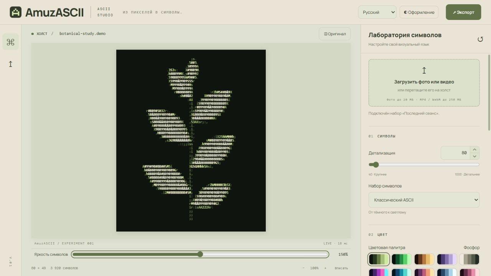
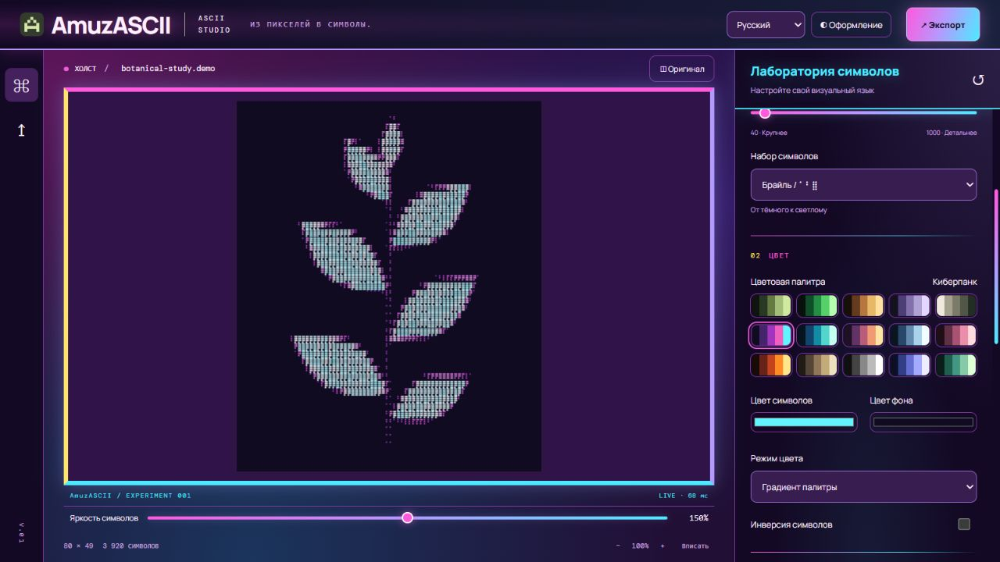
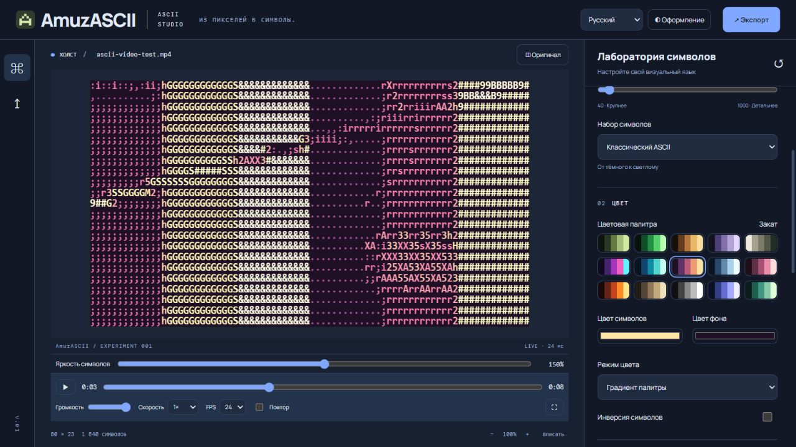

<div align="center">


# AmuzASCII

### Из пикселей — в символы.

Локальная студия ASCII-арта для изображений и видео.<br>
Настраивайте символы, экспериментируйте с цветом и наблюдайте результат в реальном времени.


[Возможности](#возможности) · [Скриншоты](#скриншоты) · [Запуск](#запуск) · [Разработка](#разработка) · [Документация](docs/guide.md)

</div>



## Возможности

Загрузите фото или видео, выберите визуальный язык и соберите свой вариант ASCII-арта. Медиа обрабатываются в браузере: редактор не отправляет их на Python-сервер.

| | Что можно настроить |
| :--- | :--- |
| **Символы** | От **40 до 1000 столбцов**, ползунок и ввод с клавиатуры. 14 наборов — от классического ASCII до Брайля — и собственный набор. |
| **Цвет** | 15 палитр, исходные цвета изображения, одноцветный режим, свои цвета букв и фона. |
| **Коррекции** | Яркость, контраст, насыщенность, гамма, инверсия, поворот и отражение. Отдельная **яркость букв 0–300%** под холстом. |
| **Видео** | Проигрыватель с паузой, перемоткой, скоростью, громкостью, повтором и полным экраном. Коррекции применяются к кадрам во время просмотра. |
| **Наборы** | Готовые коррекции, собственные сохранения, импорт и экспорт JSON. Последние настройки восстанавливаются автоматически. |
| **Оформление** | **12 тем**, включая Cyberpunk и две неоновые. Настройка акцента, плотности, текста, панели и скруглений. Интерфейс на **русском и английском**. |

### Экспорт результата

Кнопка **«Экспорт»** в правом верхнем углу открывает отдельное окно сохранения.

| Формат | Для чего |
| :--- | :--- |
| **PNG** | Изображение без потерь. |
| **JPEG / WebP** | Компактный файл с выбором качества. |
| **SVG** | Векторные символы для масштабирования. |
| **TXT** | Чистый ASCII-текст. |
| **HTML** | Отдельная страница с цветным ASCII-артом. |
| **WebM / MP4** | Запись ASCII-видео в формате, поддерживаемом браузером. |

> Запись видео идёт в реальном времени **без звука**. MP4 доступен, если браузер поддерживает его кодирование; также можно сохранить отдельный кадр.

## Скриншоты

### Неоновый город

Многоцветный интерфейс, палитры изображения и Unicode-символы. Тема оформления и цвета самого ASCII-арта настраиваются независимо.



### ASCII-видеоплеер

Перематывайте видео, останавливайте кадр и меняйте коррекции, не покидая редактор.



<sub>Скриншоты сделаны в приложении на демонстрационных материалах.</sub>

## Запуск

### Docker Compose

Нужны Docker и Compose v2 с поддержкой Linux-контейнеров. Из корня репозитория:

```bash
docker compose up --build -d
```

Откройте **[http://127.0.0.1:8000](http://127.0.0.1:8000)**. Docker сам соберёт Vue и запустит Python-сервер.

```bash
docker compose logs -f web   # журнал приложения
docker compose down          # остановка
```

Если нужен другой порт, скопируйте `.env.example` в `.env` и задайте, например, `AMUZASCII_PORT=8080`. По умолчанию приложение доступно только на локальном компьютере.

### Локально

**Требования:** Python **3.11+**, Node.js **20.19+ или 22.12+**, npm.

После клонирования сначала соберите интерфейс: каталог `frontend/dist` исключён из Git. Затем установите Python-зависимости и запустите сервер.

**Windows / PowerShell** — из корня проекта:

```powershell
npm.cmd --prefix frontend ci
npm.cmd --prefix frontend run build

python -m venv .venv
.venv\Scripts\python.exe -m pip install -r requirements.txt
.venv\Scripts\python.exe run.py
```

<details>
<summary><b>macOS / Linux</b></summary>

```bash
npm --prefix frontend ci
npm --prefix frontend run build

python3 -m venv .venv
.venv/bin/python -m pip install -r requirements.txt
.venv/bin/python run.py
```

</details>

Откройте **[http://127.0.0.1:8000](http://127.0.0.1:8000)**. Для остановки нажмите `Ctrl+C`.

## Первый ASCII-арт

1. Перетащите изображение или видео на холст либо нажмите **«Загрузить фото или видео»**.
2. Выберите детализацию, набор символов и цветовую палитру.
3. Настройте коррекции справа, а яркость букв — ползунком под изображением.
4. Сохраните настройки в набор или скачайте результат через **«Экспорт»**.

Для видео удобно начать с набора **«Видео / быстрый»** и 80–160 столбцов. Более плотная сетка даёт больше деталей, но требует больше ресурсов.

## Как это работает

**Vue 3 + Vite** отвечают за интерфейс, **Web Worker** — за обработку вне основного потока. Во время изменения настроек работает быстрый предпросмотр; после короткой паузы изображение показывается как настоящий **SVG с текстовыми контурами**. Масштабирование SVG не растягивает растровые буквы. Видео и промежуточные кадры используют отрисовку шрифта или **WebGL2**. При недоступности ускоренного пути предусмотрена Canvas-отрисовка.

**FastAPI + Pillow** обслуживают приложение, демонстрационное изображение и отдельный API конвертации. Предпросмотр работает в браузере и не делает запрос к API при каждом изменении ползунка.

Настройки и наборы хранятся в `localStorage`. Медиафайлы в сохранения не входят; для переноса наборов между браузерами используйте JSON.

### Что учитывать

- Изображения: до **20 МБ** и **25 мегапикселей**. Видео: до **250 МБ**; поддержка кодеков зависит от браузера.
- Детализация — число столбцов; строки вычисляются по пропорциям изображения, максимум **2000**.
- При плотной сетке буква может занимать меньше пикселя экрана: для просмотра её формы нужен больший масштаб.
- Скорость обработки зависит от устройства, сетки и видео. Выбранный FPS — целевая частота.
- Шрифты интерфейса загружаются из Google Fonts; без сети используются системные замены.

## Разработка

Запустите Python-сервер, а во втором терминале — Vite:

```bash
npm --prefix frontend run dev
```

Интерфейс разработки: **[http://127.0.0.1:5173](http://127.0.0.1:5173)**. Vite перенаправляет `/api` на `127.0.0.1:8000`. На Windows при необходимости используйте `npm.cmd`.

```text
backend/                 FastAPI, конвертация Pillow и тесты API
frontend/src/            Vue, рендерер, темы, переводы и экспорт
frontend/tests/          Проверки рендера в браузере
presets/                 Готовые наборы коррекций в JSON
docs/                    Подробное руководство и скриншоты
Dockerfile               Сборка интерфейса и Python-приложения
compose.yaml             Запуск через Docker Compose
run.py                   Локальный запуск сервера
```

### Проверки

В активированном Python-окружении, из корня репозитория:

```bash
python -m pip install -r requirements-dev.txt
python -m pytest backend -q
npm --prefix frontend test
npm --prefix frontend run build
```

При работающем Vite откройте **[проверки рендера](http://127.0.0.1:5173/tests/preview.html)**: они проверяют коррекции, чёткость букв, яркость, сохранение сетки и горизонтальные полосы.

Подробнее о темах, API, настройках и работе с видео — в **[полном руководстве](docs/guide.md)**.
